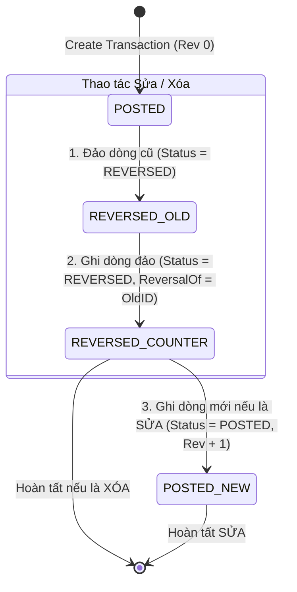
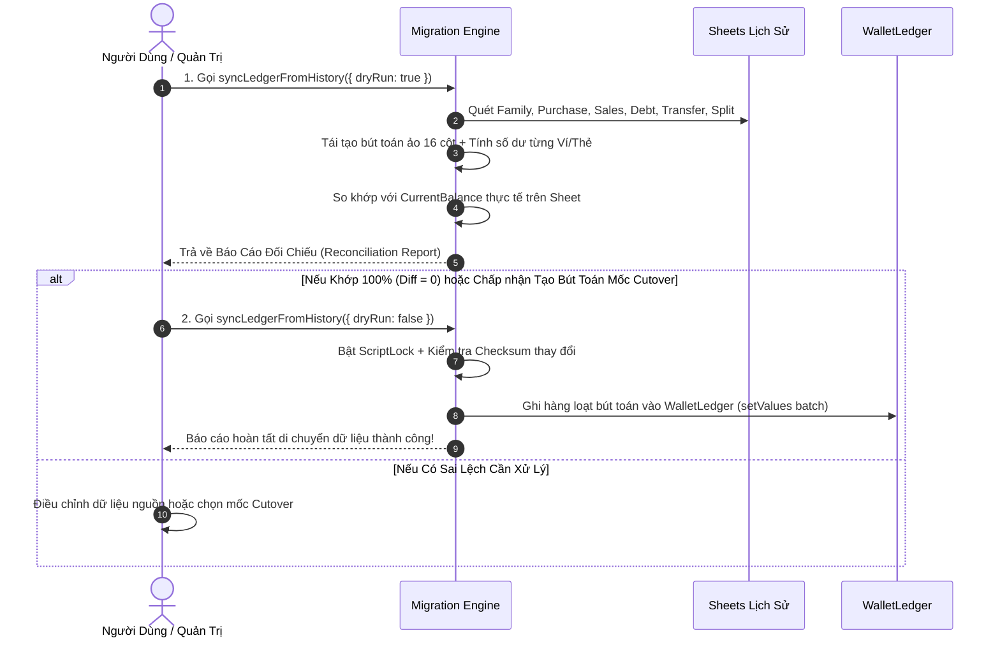

# BẢN THIẾT KẾ KIẾN TRÚC TỔNG THỂ: SỔ CÁI TÀI CHÍNH TRUNG TÂM (WALLET LEDGER)
**Hệ thống Quản lý Tài chính Phân tán — Phiên bản 2.0 (Event-Sourced Ledger Architecture)**

---

## 1. MỤC TIÊU VÀ NGUYÊN TẮC THIẾT KẾ CỐT LÕI

### 1.1 Mục Tiêu
1. **Đơn nguồn chân lý tài chính (Single Source of Financial Truth):** Mọi dòng tiền (`CASH`), dư nợ thẻ tín dụng (`CARD_DEBT`), công nợ phải thu (`PARTNER_RECEIVABLE`) và công nợ phải trả (`PARTNER_PAYABLE`) từ tất cả các phân hệ (`Family`, `Purchase`, `Sales`, `Debt`, `Transfer`, `TripSplit`) đều được ghi nhận vào một sổ cái duy nhất: `WalletLedger`.
2. **Bất biến và Kiểm toán toàn vẹn (Immutability & Full Audit Trail):** Không bao giờ xóa cứng dữ liệu kế toán đã phát sinh. Mọi thao tác Sửa/Xóa đều thông qua bút toán đảo (Reversal Entry) với liên kết nguồn rõ ràng.
3. **Chống trùng lặp tuyệt đối (Strict Idempotency):** Khóa định danh 8 thành phần ngăn ngừa triệt để việc ghi trùng do bấm nút nhiều lần, timeout mạng hay lỗi đồng thời.
4. **Hiệu năng cao với Cờ Checkpoint (Audit & Checkpoint Flagging):** Đánh dấu trực tiếp mã Checkpoint lên từng dòng bút toán, giúp việc tính số dư chỉ cần quét các giao dịch mới phát sinh sau mốc chốt mà không cần duyệt lại toàn bộ lịch sử.

### 1.2 Nguyên Tắc Kế Toán Kép (Double-Entry Invariants)
* **Đẳng thức Toàn vẹn Dòng tiền Nhóm (INV-13):**
  $$\text{Advanced Outflow (Tiền ứng)} - \text{True Personal Cost (Chi phí thực cá nhân)} = \sum \text{Receivables} - \sum \text{Payables}$$
* **Đẳng thức Cân đối Tài sản (Net Asset Equation):**
  $$\text{Tổng Tài Sản Ròng} = \sum \text{Số dư Ví (CASH)} + \sum \text{Phải Thu} - \sum \text{Dư Nợ Thẻ} - \sum \text{Phải Trả}$$

---

## 2. CẤU TRÚC BẢNG DỮ LIỆU CHUẨN (`WalletLedger` - 16 CỘT)

| Cột | Tên trường | Kiểu dữ liệu | Mô tả chi tiết |
| :--- | :--- | :--- | :--- |
| **A** | `LedgerID` | String | Mã định danh duy nhất của bút toán (vd: `LEDG_20261009_0001`) |
| **B** | `WalletID` | String | ID của Ví tiền mặt, Thẻ tín dụng, hoặc Đối tác công nợ (vd: `W_RESONA`, `CC_RAKUTEN`, `P_AHUAN`) |
| **C** | `WalletName` | String | Tên hiển thị của ví/thẻ/đối tác (vd: *Resona Bank*, *Rakuten Card*, *A Huân*) |
| **D** | `Date` | String | Ngày nghiệp vụ phát sinh hiệu lực, chuẩn ISO `YYYY-MM-DD` |
| **E** | `Amount` | Number | Số tiền thực tế phát sinh (luôn là số dương \(> 0\)) |
| **F** | `Direction` | Enum | Hướng biến động: `IN` (Vào), `OUT` (Ra), `INCREASE` (Tăng nợ), `DECREASE` (Giảm nợ) |
| **G** | `EffectType` | Enum | Loại tác động tài chính: `CASH`, `CARD_DEBT`, `PARTNER_RECEIVABLE`, `PARTNER_PAYABLE` |
| **H** | `SourceModule` | Enum | Phân hệ nguồn: `Family`, `Purchase`, `Sales`, `Debt`, `Transfer`, `TripSplit`, `System` |
| **I** | `SourceID` | String | Mã chứng từ/giao dịch nguồn (vd: `FML_101`, `PO_202`, `ORD_303`, `DEBT_01`, `TRIP_05`) |
| **J** | `EventType` | String | Mã định danh loại nghiệp vụ cụ thể (vd: `FAMILY_EXPENSE`, `PURCHASE_CARD_DEBT`, `LEND_MONEY`...) |
| **K** | `IdempotencyKey` | String | Khóa chống ghi trùng 8 thành phần: `SourceModule_SourceID_PaymentID_WalletID_EventType_EffectType_Direction_Rev` |
| **L** | `Status` | Enum | Trạng thái hiệu lực: `POSTED` (Có hiệu lực), `REVERSED` (Đã bị đảo/hủy) |
| **M** | `Note` | String | Diễn giải nội dung giao dịch / Lý do điều chỉnh |
| **N** | `CreatedAt` | String | Dấu thời gian hệ thống ghi nhận (ISO `YYYY-MM-DDTHH:mm:ss.sssZ`) |
| **O** | `ReversalOf` | String | Nếu là bút toán đảo, ghi `LedgerID` của bút toán cũ bị đảo. Nếu không, để trống `""` |
| **P** | `CheckpointRef` | String | Mã mốc chốt đã khóa sổ dòng này (vd: `CP_RESONA_20260930`). Nếu chưa chốt, để trống `""` |

---

## 3. MA TRẬN ÁNH XẠ NGHIỆP VỤ TOÀN DIỆN (FULL EVENT MATRIX)

```mermaid
flowchart TD
    subgraph UI_Modules["Phân Hệ Nghiệp Vụ (Source Modules)"]
        FML["Tab 2: Family"]
        TRF["Tab 1: Transfer & Card Pay"]
        PUR["Tab 3: Purchase (Mua hàng)"]
        SAL["Tab 3: Sales (Bán hàng)"]
        DBT["Tab 4: Debt (Sổ Nợ)"]
        SPL["Tab 7: Split Trip (Chia tiền)"]
        SYS["System: Opening & Adjustments"]
    end

    subgraph Ledger_Engine["WalletLedger Engine (Sổ Cái Trung Tâm)"]
        CASH_E["CASH (Tiền ví)"]
        CARD_E["CARD_DEBT (Nợ thẻ)"]
        RECV_E["PARTNER_RECEIVABLE (Phải thu)"]
        PAY_E["PARTNER_PAYABLE (Phải trả)"]
    end

    FML -->|Chi tiêu / Thu nhập / Lãi / Phí| CASH_E
    TRF -->|Chuyển tiền nội bộ| CASH_E
    TRF -->|Thanh toán nợ thẻ| CASH_E & CARD_E
    PUR -->|Mua tiền mặt / Hoàn tiền ví| CASH_E
    PUR -->|Quẹt thẻ đã trừ / Hoàn thẻ| CARD_E
    SAL -->|Bán thu tiền ngay| CASH_E
    SAL -->|Bán ghi nợ / Khách trả nợ| CASH_E & RECV_E
    DBT -->|Cho vay / Thu nợ vay| CASH_E & RECV_E
    DBT -->|Đi vay / Trả nợ vay| CASH_E & PAY_E
    SPL -->|ME ứng tiền cả nhóm| CASH_E
    SPL -->|Chốt chuyến: ghi nhận nợ| RECV_E & PAY_E
    SYS -->|Khởi tạo & Điều chỉnh kiểm kê| CASH_E & CARD_E & RECV_E & PAY_E
```

### Bảng Chi Tiết Định Danh Nghiệp Vụ

| Phân hệ | Hành động người dùng | EventType | Dòng 1 (Tiền ví / Thẻ) | Dòng 2 (Công nợ đối ứng) |
| :--- | :--- | :--- | :--- | :--- |
| **Family** | Chi tiêu sinh hoạt hàng ngày | `FAMILY_EXPENSE` | `CASH` + `OUT` | *(Không)* |
| | Thu nhập (Lương, thưởng, phụ cấp...) | `FAMILY_INCOME` | `CASH` + `IN` | *(Không)* |
| | Phí chuyển khoản / Phí duy trì tài khoản | `FEE` | `CASH` + `OUT` | *(Không)* |
| | Tiền lãi gửi tiết kiệm nhận được | `INTEREST` | `CASH` + `IN` | *(Không)* |
| **Transfer**| Chuyển khoản giữa 2 ví nội bộ | `TRANSFER_OUT` / `TRANSFER_IN` | Ví A: `CASH OUT` Ví B: `CASH IN` | *(Không)* |
| | Thanh toán dư nợ thẻ tín dụng | `CARD_PAYMENT` | Ví trả: `CASH OUT` | Thẻ tín dụng: `CARD_DEBT DECREASE` |
| **Purchase**| Mua hàng thanh toán tiền mặt / ví | `PURCHASE_CASH_OUT` | `CASH` + `OUT` | *(Không)* |
| | Mua hàng quẹt thẻ *(đã trừ tiền thực tế)* | `PURCHASE_CARD_DEBT` | `CARD_DEBT` + `INCREASE` | *(Không)* |
| | Đơn Pre-order chờ ship | *(Chờ trừ tiền thẻ)* | **Không ghi Ledger** *(Chỉ tạm trừ Hạn mức khả dụng)* | *(Không)* |
| | Hủy đơn quẹt thẻ: hoàn tiền về thẻ | `PURCHASE_CARD_REFUND` | `CARD_DEBT` + `DECREASE` | *(Không)* |
| | Hủy đơn mua: hoàn tiền vào ví Debit | `PURCHASE_REFUND_IN` | `CASH` + `IN` | *(Không)* |
| **Sales** | Bán hàng thu tiền mặt / chuyển khoản ngay | `SALES_CASH_IN` | `CASH` + `IN` | *(Không)* |
| | Bán hàng cho khách ghi nợ | `SALES_DEBT_RECORD` | *(Chưa có dòng tiền ví)* | Khách hàng: `PARTNER_RECEIVABLE INCREASE` |
| | Thu nợ bán hàng từ khách (từng đợt/toàn bộ) | `SALES_DEBT_COLLECT` | `CASH` + `IN` | Khách hàng: `PARTNER_RECEIVABLE DECREASE` |
| **Debt** | Cho đối tác vay tiền | `LEND_MONEY` | `CASH` + `OUT` | Người vay: `PARTNER_RECEIVABLE INCREASE` |
| | Thu hồi nợ cho vay | `COLLECT_LOAN` | `CASH` + `IN` | Người vay: `PARTNER_RECEIVABLE DECREASE` |
| | Đi vay tiền từ chủ nợ | `BORROW_MONEY` | `CASH` + `IN` | Chủ nợ: `PARTNER_PAYABLE INCREASE` |
| | Trả nợ tiền đã vay | `REPAY_LOAN` | `CASH` + `OUT` | Chủ nợ: `PARTNER_PAYABLE DECREASE` |
| | Thỏa thuận cấn trừ nợ 2 chiều | `DEBT_NETTING` | *(Không đụng tiền ví)* | `PARTNER_RECEIVABLE DECREASE` `PARTNER_PAYABLE DECREASE` |
| **TripSplit**| ME thanh toán tiền thay cho cả nhóm | `GROUP_ADVANCE_CASH_OUT` | `CASH` + `OUT` (100% tiền chi) | *(Không)* |
| | Chốt chuyến: ghi nhận thành viên nợ mình | `SPLIT_RECEIVABLE_RECORD`| *(Không đụng tiền ví)* | Thành viên: `PARTNER_RECEIVABLE INCREASE` |
| | Chốt chuyến: ghi nhận mình nợ thành viên | `SPLIT_PAYABLE_RECORD` | *(Không đụng tiền ví)* | Chủ nợ: `PARTNER_PAYABLE INCREASE` |
| | Xuất nợ sang Tab 4 (Nợ kế thừa) | *(Inherited Record)* | **Chặn hook LEND/BORROW** | *(Chỉ thu nợ qua COLLECT_LOAN)* |
| **System** | Số dư đầu kỳ / Mốc khởi tạo | `OPENING_BALANCE` | `CASH / CARD_DEBT / ...` | *(Tùy loại tài sản khởi tạo)* |
| | Bút toán điều chỉnh kiểm kê chênh lệch | `ADJUSTMENT` | `CASH / CARD_DEBT / ...` | *(Tùy loại tài sản điều chỉnh)* |

---

## 4. QUY TẮC BẤT BIẾN KHI CREATE, EDIT, DELETE & CHECKPOINT

### 4.1 Tạo mới (CREATE)
1. Tạo mã `IdempotencyKey` với `Rev = 0`.
2. Kiểm tra trong `WalletLedger`: nếu đã có dòng nào trùng key và đang có `Status == "POSTED"` $\rightarrow$ Từ chối ghi (chống trùng).
3. Ghi các bút toán với `Status = "POSTED"`, `CheckpointRef = ""` và `ReversalOf = ""`.

### 4.2 Xóa giao dịch (DELETE)
1. Kiểm tra trạng thái khóa sổ: Nếu dòng có `CheckpointRef != ""` $\rightarrow$ **Chặn xóa trực tiếp** (buộc tạo bút toán điều chỉnh `ADJUSTMENT`).
2. Nếu chưa khóa sổ (`CheckpointRef == ""`):
   - Cập nhật dòng gốc: `Status = "REVERSED"`.
   - Ghi thêm dòng đảo (Counter-entry): `Status = "REVERSED"`, `Direction` đảo ngược, `ReversalOf = LedgerID_gốc`.
   - *Nguyên lý triệt tiêu:* Khi tính số dư, hệ thống chỉ cộng dòng `POSTED`. Cả dòng gốc và dòng đảo đều mang `REVERSED` nên biến động tài chính của giao dịch này trở về đúng $0$.

### 4.3 Sửa giao dịch (EDIT)
1. Kiểm tra trạng thái khóa sổ: Nếu bất kỳ vế nào của giao dịch có `CheckpointRef != ""` $\rightarrow$ **Chặn sửa trực tiếp**.
2. Nếu chưa khóa sổ:
   - Thực hiện bước Đảo dòng cũ (như quy trình XÓA ở trên).
   - Ghi các bút toán mới theo dữ liệu đã sửa với `Status = "POSTED"`, `Rev = Rev_cũ + 1`, `CheckpointRef = ""`.

### 4.4 Quy trình Đánh dấu Mốc Chốt (CHECKPOINT)
Khi người dùng bấm "Chốt số dư Ví A = $X$":
1. Ghi bản ghi mốc chốt vào sheet `WalletCheckpoints`: `{ CheckpointID: "CP_W_A_20261009", WalletID: "W_A", Balance: X, Timestamp: now }`.
2. Quét tất cả các dòng của `W_A` trong `WalletLedger` đang có `CheckpointRef == ""` $\rightarrow$ Cập nhật `CheckpointRef = "CP_W_A_20261009"`.

---

## 5. CÔNG THỨC TÍNH SỐ DƯ TỐI GIẢN (TAB 1 DASHBOARD)

Nhờ có cờ `CheckpointRef`, Tab 1 chỉ cần đọc mốc chốt gần nhất và tính tổng các dòng **chưa chốt (`CheckpointRef == ""`)**:

### 5.1 Số Dư Ví Tiền Mặt / Tài Khoản Ngân Hàng (`CASH`)
$$\text{Số Dư Hiện Tại} = \text{Mốc Chốt Gần Nhất} + \sum_{POSTED,\ CheckpointRef == ""} (\text{CASH IN}) - \sum_{POSTED,\ CheckpointRef == ""} (\text{CASH OUT})$$

### 5.2 Dư Nợ Thẻ Tín Dụng (`CARD_DEBT`)
$$\text{Dư Nợ Hiện Tại} = \text{Mốc Chốt Nợ Gần Nhất} + \sum_{POSTED,\ CheckpointRef == ""} (\text{CARD\_DEBT INCREASE}) - \sum_{POSTED,\ CheckpointRef == ""} (\text{CARD\_DEBT DECREASE})$$

### 5.3 Hạn Mức Thẻ Khả Dụng
$$\text{Hạn Mức Khả Dụng} = \text{Hạn Mức Thẻ} - \text{Dư Nợ Hiện Tại} - \sum \text{Đơn Pre-order chờ ship (Chưa trừ thẻ)}$$

### 5.4 Công Nợ Từng Đối Tác $P$ (Partner Receivables & Payables)
$$\text{Phải Thu}(P) = \text{Mốc Chốt}(P) + \sum_{POSTED,\ CheckpointRef == ""} (\text{RECEIVABLE INCREASE})_P - \sum_{POSTED,\ CheckpointRef == ""} (\text{RECEIVABLE DECREASE})_P$$
$$\text{Phải Trả}(P) = \text{Mốc Chốt}(P) + \sum_{POSTED,\ CheckpointRef == ""} (\text{PAYABLE INCREASE})_P - \sum_{POSTED,\ CheckpointRef == ""} (\text{PAYABLE DECREASE})_P$$

---

## 6. QUY TRÌNH MIGRATION 2 GIAI ĐOẠN AN TOÀN (`syncLedgerFromHistory`)

### Chiến Lược Cutover (Khuyến nghị cho Dữ liệu Quá Khứ):
* Ghi 1 dòng `OPENING_BALANCE` tại ngày chốt sổ gần nhất cho mỗi Ví/Thẻ/Đối tác.
* Ghi toàn bộ các giao dịch phát sinh sau mốc chốt vào `WalletLedger` với `CheckpointRef = ""` $\rightarrow$ **Đảm bảo 100% khớp số dư ngay lập tức mà không sợ sai lệch lịch sử cũ!**

---

## 7. KẾ HOẠCH TRIỂN KHAI TỪNG BƯỚC (ROADMAP)

1. **Giai đoạn 1: Chuẩn hóa Engine Sổ Cái (`Server_FinancialLedger.js`)**
   - Định nghĩa header 16 cột (`LEDGER_HEADERS_16`).
   - Cài đặt các hàm cốt lõi: `postFinancialEvents`, `reverseFinancialEvents`, `replaceFinancialEvents`, `markCheckpointInLedger`.
   - Cài đặt các hàm đọc số dư siêu tốc: `getWalletBalancesFromLedger`, `getCardDebtsFromLedger`, `getPartnerDebtsFromLedger`.
2. **Giai đoạn 2: Tích hợp Event Hooks vào Từng Phân Hệ**
   - Tab 2 (`Server_Tab2.js`): Hook `Family` (Chi tiêu, Thu nhập, Phí, Lãi).
   - Tab 1 (`Server_Tab1.js`): Hook `Transfer` (Chuyển khoản) và `CardPayment` (Trả nợ thẻ).
   - Tab 3 (`Server_Tab3.js`): Hook `Purchase` (Mua hàng quẹt thẻ/tiền mặt, hoàn tiền) và `Sales` (Bán hàng, thu nợ bán hàng).
   - Tab 4 (`Server_Tab4.js`): Hook `Debt` (Vay/Cho vay, Thu nợ/Trả nợ, Cấn trừ nợ).
   - Tab 7 (`Server_Tab7.js`): Hook `TripSplit` (ME ứng tiền `GROUP_ADVANCE_CASH_OUT`, chốt chuyến `SPLIT_*_RECORD`).
3. **Giai đoạn 3: Chuyển Đổi Tab 1 Đọc Dữ Liệu Từ `WalletLedger`**
   - Thay thế toàn bộ logic quét phân tán cũ bằng hàm đọc trực tiếp từ `WalletLedger` qua cờ `CheckpointRef`.
4. **Giai đoạn 4: Chạy Migration Đối Chiếu Lịch Sử & Kiểm Thử Toàn Diện**
   - Chạy `dryRun: true` để đối chiếu số dư từng tài khoản.
   - Bấm xác nhận commit `dryRun: false`.
   - Chạy bộ kiểm thử tự động (Unit Test Suite 180+ tests) đảm bảo không có bất kỳ sai lệch nào.

---
*Bản thiết kế đã được kiểm chứng và sẵn sàng để chuyển sang giai đoạn thực thi.*
